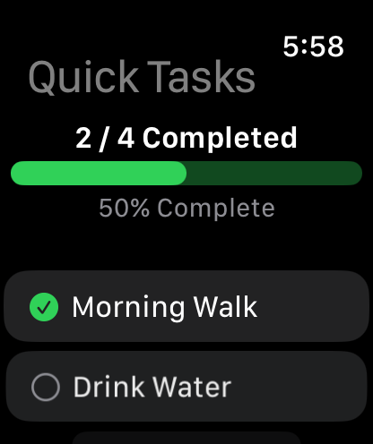
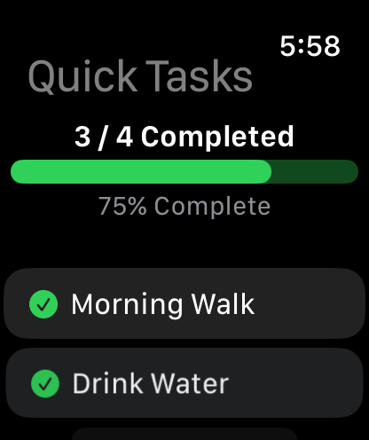
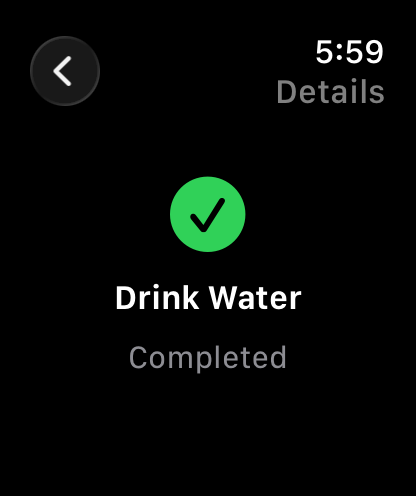
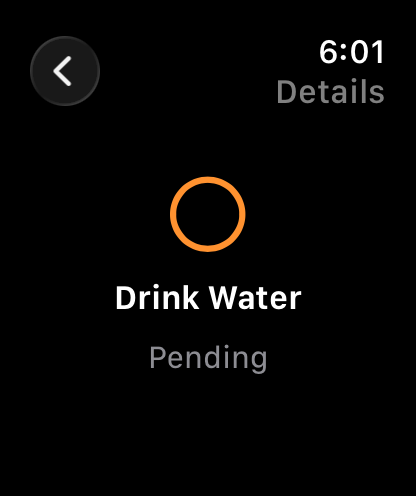

# SE4041 – Practical 05: Building a watchOS App with SwiftUI

Quick Tasks – a Watch-only SwiftUI app to view and complete daily tasks, with a completion count, progress percentage, task details and reset.

**Name:** Abisheak S  
**Student ID:** IT21244384

## Screenshots

